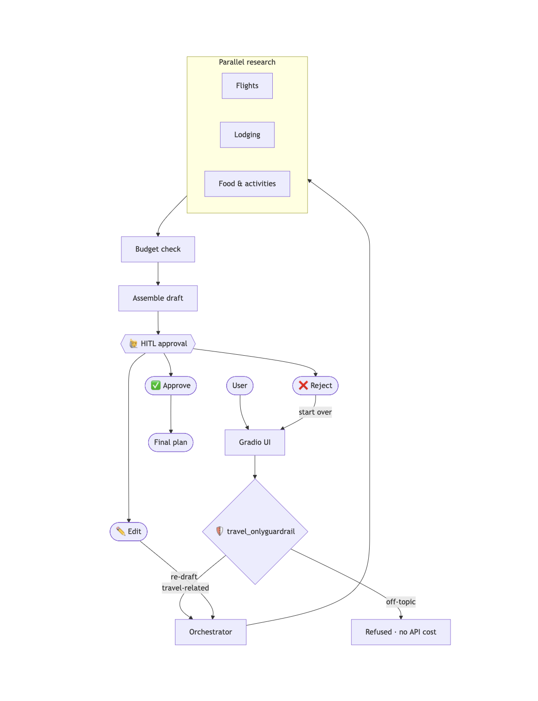

# Multi-agent AI travel planner

A travel planner I built to play with the OpenAI Agents SDK. You tell it where you want to go, for how long and your budget, and a few agents go off and look up flights, hotels, food and things to do. Then it puts together a day-by-day plan and waits for you to approve it before finalizing.

Example: "5 days in Lisbon, 1500 EUR, flying from Toronto".



## How it works

1. The Gradio chat asks 3 questions (destination, number of days, budget) and an optional origin city.
2. The first message goes through an input guardrail, so if it's not about travel it gets rejected before any agent runs.
3. The orchestrator runs the flights, lodging and food/activities agents at the same time with `asyncio.gather`.
4. The budget agent takes their results, converts everything to one currency and checks it against the budget.
5. An assembler agent turns all of that into a structured itinerary (`PlanDraft`). The totals are calculated in Python (`TripPlan.recompute_budget()`), not by the model, because the model kept getting the math wrong.
6. The plan goes to an approval step. You can approve it, reject it, or type what you want changed and it re-plans.

The approval step uses the SDK's `needs_approval=True` tool. When the run pauses I save the state to a JSON file in `.sessions/`, so the approval still works after restarting the server.

## Agents

| Agent | What it does | Tools |
| --- | --- | --- |
| FlightsAgent | finds 2-3 flight options | Apify Google Flights scraper (MCP) |
| LodgingAgent | finds 2-3 hotels | Apify Booking.com scraper (MCP) |
| FoodActivitiesAgent | restaurants, sights, weather | `find_places`, `get_weather` |
| BudgetAgent | totals and currency conversion | `convert_currency` |
| PlanAssembler | builds the itinerary | structured output |
| Finalizer | locks in the plan after approval | `finalize_plan` |
| RelevanceCheck | blocks non-travel input | input guardrail |

If one of the research agents fails or gets stuck, it returns "data unavailable" and the rest of the plan still gets made.

## APIs used

Most of it runs on free APIs with no key:

- Nominatim (OpenStreetMap) for geocoding
- Open-Meteo for the weather
- Overpass for places, or Geoapify if you set `GEOAPIFY_API_KEY`
- Frankfurter for currency rates

Flights and hotels need Apify (`APIFY_TOKEN` + `ENABLE_APIFY=true`). Those actors are paid and a bit slow. Without them, the plan just says flights and hotels aren't available.

## Running it

```bash
python -m venv venv
source venv/bin/activate    # on windows: venv\Scripts\activate
pip install -r requirements.txt
cp .env.example .env        # add your OPENAI_API_KEY
python -m app.gradio_app
```

Only `OPENAI_API_KEY` is required. The other settings are in `.env.example`.

You can also run some modules on their own to test them, e.g.:

```bash
python -m app.tools.weather
python -m app.agents.orchestrator
python -m app.hitl.approval_gate
```

Set `DEBUG_AGENTS=1` when running the orchestrator to see every tool call.

## Tests

```bash
pytest -q
```

The tests only cover the budget calculation and the input parsing, so you don't need any API keys to run them.

## Project structure

```
app/
  config.py            settings from .env
  models/              TripRequest, ItineraryItem, TripPlan
  tools/               geocoding, weather, places, currency, apify
  agents/              the agents + orchestrator + guardrail
  hitl/                approval gate
  gradio_app.py        the chat UI
tests/
```

## Known limitations

- It doesn't ask for a start date, so it assumes the trip starts 30 days from today.
- Flights only work if you give an origin city.
- The Google Flights scraper sometimes gets blocked. When that happens, flights just show as unavailable.
- The number of travelers is always 1 for now.

## Stack

Python 3.12, openai-agents 0.19, Pydantic v2, httpx, Gradio, Apify MCP, pytest
